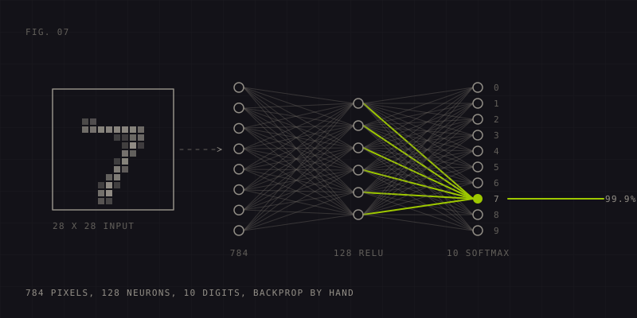
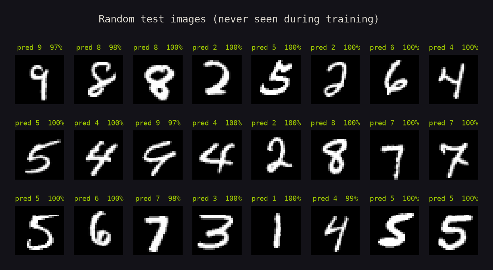
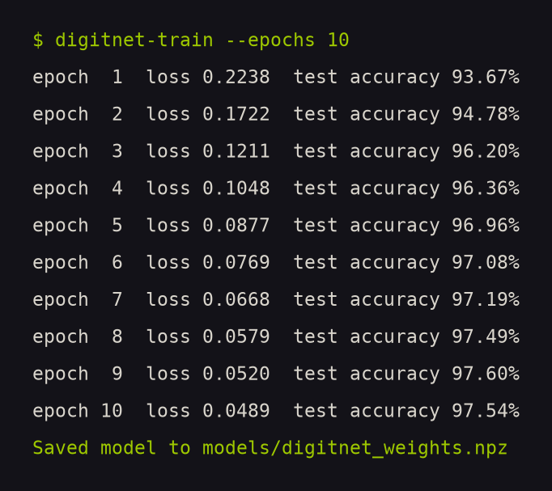
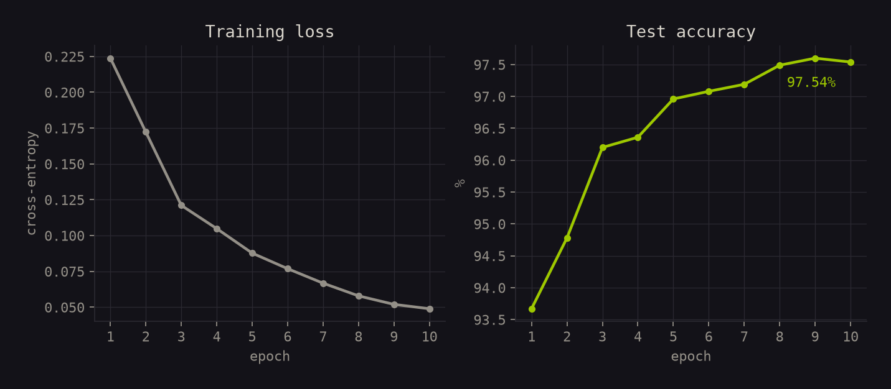
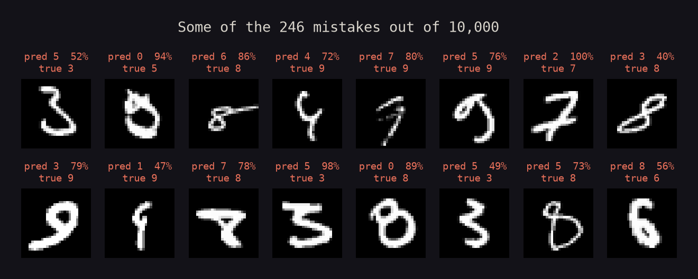
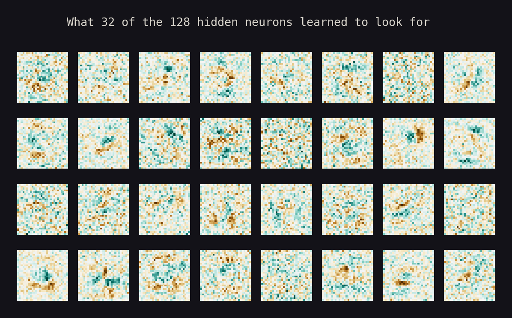

# DigitNet

A neural network that recognizes handwritten digits (trained on the MNIST dataset), written in pure NumPy, with no deep-learning framework. Forward pass, backpropagation and gradient descent are all implemented by hand.

**Architecture:** 784 inputs → 128 hidden (ReLU) → 10 outputs (softmax), trained with mini-batch SGD on cross-entropy loss.
**Result:** 97.54% test accuracy after 10 epochs, trained in under 10 seconds on a laptop CPU.



## See it working

Predictions on random digits from the test set, which the network never saw during training:



Training output and learning curves:

<p>
  
  &nbsp;
  
</p>

Where it goes wrong: 246 of 10,000 test digits are misclassified, and many of them are hard for people to read too:



What the hidden layer learned. Each square is one neuron's 784 input weights drawn as a 28×28 image. Teal pixels push the neuron to fire and brown pixels hold it back, so many of them look like fragments of strokes:



Every image here comes from a real training run of this code. Run `python scripts/make_figures.py` to regenerate them (see [Usage](#usage)).

## Project structure

```
digitnet/
├── src/digitnet/
│   ├── __init__.py       # package entry, exposes NeuralNetwork
│   ├── data.py           # download + load MNIST, one-hot encoding
│   ├── model.py          # the network: forward, backward, step, save/load
│   ├── train.py          # training loop + CLI
│   └── predict.py        # load a trained model, show predictions
├── tests/
│   └── test_model.py     # unit tests incl. numerical gradient check
├── scripts/
│   └── make_figures.py   # trains and saves the README figures to assets/
├── assets/               # images used in this README
├── data/                 # MNIST downloads here (git-ignored)
├── models/               # trained weights saved here (git-ignored)
├── pyproject.toml        # package metadata + dependencies
├── .gitignore
└── README.md
```

## Setup

```bash
git clone https://github.com/Himanshu-Khadka/DigitNet.git
cd DigitNet
python -m venv .venv
source .venv/bin/activate        # Windows: .venv\Scripts\activate
pip install -e ".[dev]"
```

## Usage

```bash
# Train (downloads MNIST on first run, ~11 MB)
digitnet-train --epochs 10 --lr 0.1 --hidden 128

# See predictions from the trained model
digitnet-predict --n 5

# Run tests
pytest

# Regenerate the README figures (needs matplotlib)
pip install -e ".[viz]"
python scripts/make_figures.py
```

You can also run them as modules: `python -m digitnet.train`.

## How it works

1. **Forward:** `h = ReLU(x·W1 + b1)`, `p = softmax(h·W2 + b2)`
2. **Loss:** cross-entropy, `−log p[true digit]`
3. **Backward:** chain rule from the output back. The combined softmax + cross-entropy gradient is simply `p − y`
4. **Update:** `W ← W − lr · ∇W`

`tests/test_model.py` checks the backprop gradients against numerical finite differences.

## References

The ideas and data this project is built on:

- **Dataset:** Y. LeCun, L. Bottou, Y. Bengio and P. Haffner, [*Gradient-Based Learning Applied to Document Recognition*](https://doi.org/10.1109/5.726791), Proceedings of the IEEE, 1998. This paper introduced the MNIST database. The code downloads it from the [PyTorch dataset mirror](https://ossci-datasets.s3.amazonaws.com/mnist/).
- **Backpropagation:** D. Rumelhart, G. Hinton and R. Williams, [*Learning representations by back-propagating errors*](https://doi.org/10.1038/323533a0), Nature, 1986.
- **Weight initialization:** K. He, X. Zhang, S. Ren and J. Sun, [*Delving Deep into Rectifiers*](https://arxiv.org/abs/1502.01852), 2015. This is the "He initialization" used for the ReLU layer.
- **Learning resources:**
  - Michael Nielsen, [*Neural Networks and Deep Learning*](http://neuralnetworksanddeeplearning.com/): a free online book that builds an MNIST network from scratch.
  - 3Blue1Brown, [*Neural Networks*](https://www.3blue1brown.com/topics/neural-networks): a visual video series on how networks learn and how backprop works.
  - Stanford [CS231n course notes](https://cs231n.github.io/): softmax, cross-entropy, backprop and gradient checking.
- **Library:** [NumPy](https://numpy.org/) for all the math. [Matplotlib](https://matplotlib.org/) draws the figures.

## Ideas to extend

- Add a second hidden layer, momentum, or the Adam optimizer
- Reimplement in PyTorch and compare
- Build a convolutional network (CNN) for 99%+
